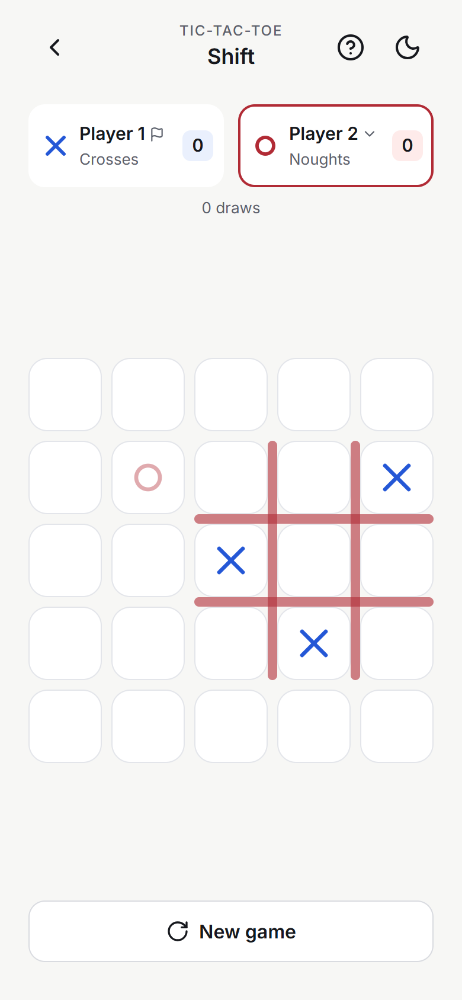
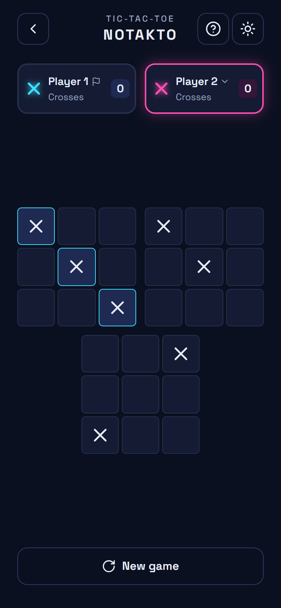
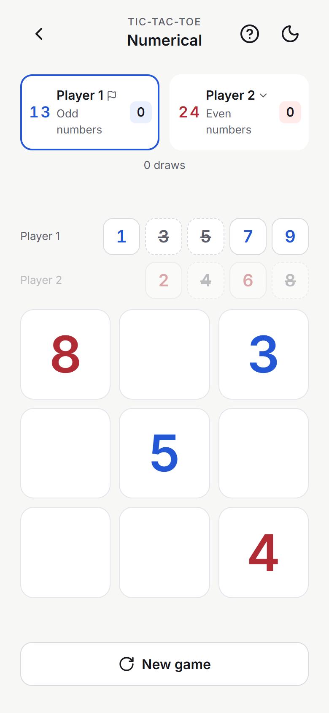
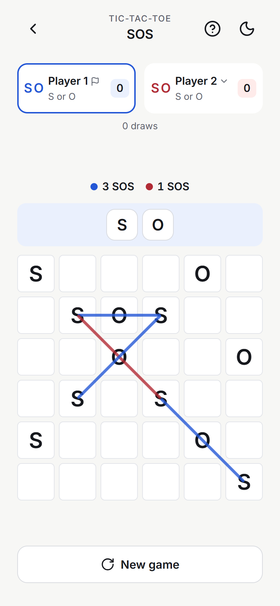

# XO Lab

Tic-tac-toe, and its stranger cousins. XO Lab is a collection of thirteen tic-tac-toe variants for two or three players sharing one phone or browser, or for one player against the AI.

**Play it at [xo-lab.vercel.app](https://xo-lab.vercel.app).**

The home screen lists each variant as a card, and tapping one opens its game at its own address, such as `/play/classic`. Every variant is played on the same screen (top bar, player cards, board, New game) with a How to play panel for its rules. The app follows the device's light or dark setting, or a theme chosen with the sun/moon toggle. It can be installed to a phone's home screen or a desktop like any app, and plays offline once installed (decision D-53).

## Variants

Player 1 is X, Player 2 is O, and in Trio Player 3 is a star.

| Variant       | Players | How it plays                                                               |
| ------------- | ------- | -------------------------------------------------------------------------- |
| **Classic**   | 2       | The original 3×3 game. Three in a row wins.                                |
| **Infinite**  | 2       | Three marks each. Place a fourth and your oldest disappears.               |
| **Ultimate**  | 2       | Nine boards in one. Where you play decides where your opponent plays next. |
| **Shift**     | 2       | A 3×3 board that slides over a 5×5 field. Place a mark, or move the board. |
| **Trio**      | 3       | Three players, one 4×4 board. First to three in a row wins.                |
| **Misère**    | 2       | Classic, but inverted. Three in a row loses.                               |
| **Notakto**   | 2       | Three boards, and everyone plays X. Don't make the last line.              |
| **Wild**      | 2       | A 4×4 board. Play X or O, your choice. Any three in a row wins.            |
| **Pyramid**   | 2       | Nine squares stacked in a pyramid. Three in a row wins.                    |
| **Harvest**   | 2       | A 5×5 board and 12 marks each. Make the most lines of three.               |
| **March**     | 2       | Four pieces each on a 4×4 board. March three into a row.                   |
| **Numerical** | 2       | Odds against evens. Make a line add up to 15.                              |
| **SOS**       | 2       | S or O, your choice. Spell SOS to score, and score to go again.            |

### A closer look

Some of these are further from the original game than their names suggest.

<table>
  <tr>
    <td width="50%" valign="top">
      
      <p><strong>Shift.</strong> Only the 3×3 board counts, and it sits on a bigger 5×5 field. On your turn you either place a mark inside the board or drag the whole board one square. Marks left outside it fade and stop counting, until the board slides back over them.</p>
    </td>
    <td width="50%" valign="top">
      
      <p><strong>Notakto.</strong> Both players play X on three boards. A board with three in a row is dead, and whoever kills the last live board loses, so the game is about forcing your opponent into it. Shown here in the dark theme.</p>
    </td>
  </tr>
  <tr>
    <td width="50%" valign="top">
      
      <p><strong>Numerical.</strong> One player has the odd numbers 1–9 and the other the even ones 2–8, each usable once. Pick a number from your tray and place it; whoever completes a line that adds up to exactly 15 wins, even if most of it is the other player’s numbers.</p>
    </td>
    <td width="50%" valign="top">
      
      <p><strong>SOS.</strong> On a 6×6 board, each turn you write S or O in any square. Spelling S-O-S in a line scores a point and gives you another turn straight away. When the board is full, whoever made the most SOSs wins.</p>
    </td>
  </tr>
</table>

Games aren't saved: reloading a variant starts a fresh game. The device keeps only the theme, who plays Player 2 (a person or the AI) and the hub's list or grid view (decisions D-41, D-49, D-50). The original plan is the spec, issue #1.

## Running it

You need Node and npm; there are no environment variables or services.

```bash
npm install
npm run dev
```

The dev server runs on http://localhost:5173.

| Command          | What it does                                                 |
| ---------------- | ------------------------------------------------------------ |
| `npm run dev`    | Start the dev server                                         |
| `npm run test`   | Run the tests once (`test:watch` keeps running them)         |
| `npm run lint`   | Check the code with oxlint                                   |
| `npm run format` | Format everything with Prettier (`format:check` only checks) |
| `npm run build`  | Type-check, then build for production into `dist/`           |
| `npm run icons`  | Regenerate the app icons in `public/` from `public/icon.svg` |

Before opening a pull request, run all four gates: `npm run lint && npm run format:check && npm run test && npm run build`.

## How it's built

React 19, TypeScript and Vite, with React Router, Tailwind CSS v4 and Lucide icons. Tests run on Vitest. Vercel deploys `main` to production and gives every other branch a preview link.

```
src/
├── game/        The rules contract every variant implements, the game session, and the shared contract tests
├── variants/    One folder per variant (info, rules, board, tests) and the registry that lists them
├── boards/      Board components shared by more than one variant
├── screens/     The game screen every variant is played on
├── hub/         The home screen
├── theme/       Design tokens for both themes, and the light/dark switching
└── ui/          Icons, the X, O and star pieces, and shared class lists
```

Adding a variant is a new folder under `src/variants/` and one entry in `src/variants/registry.ts`. The hub, the routes, the game screen and the contract tests pick it up from there.

## Docs

| Doc                                            | What's in it                                                                     |
| ---------------------------------------------- | -------------------------------------------------------------------------------- |
| [01 · Decisions](docs/01-decisions.md)         | Every decision so far, numbered and dated, including the ones later replaced     |
| [02 · The game screen](docs/02-game-screen.md) | The layout, sizes and colours every variant uses, and what each variant changes  |
| [Contributing](CONTRIBUTING.md)                | Branches, pull requests, the gates, issues and milestones                        |
| [Agents](AGENTS.md)                            | How the code is written: architecture, theming, icons, accessibility and testing |
